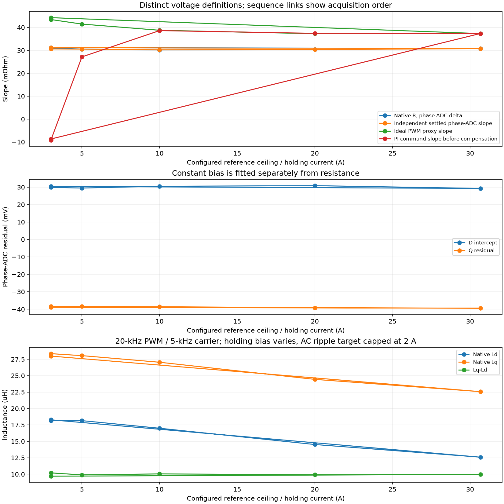
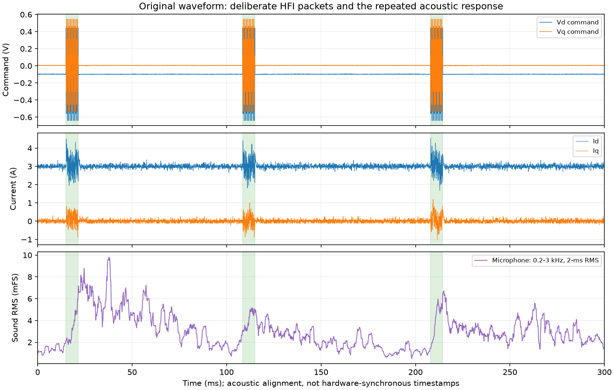

# Inductance model and current dependence, 2026-11-09

Follow-up to [finite excitation packets](bench-inductance-packets-2026-11-09.md).
The same MK5, UID `2B002C001047343031363330`, calibrated clock, wiring and
24 V / 5.5 A PSU are used. Full native telemetry remains nominal 20 kHz,
actual 20004.271990 Hz. No motor-detection result is applied or persisted.

## Separate algorithm error from test-current effects

The previous OxiFOC 1–3 A tests qualified excitation, cancellation and capture.
They were not matched to the VESC full wizard. The saved VESC R plateau is
30.6806 A, not 3 A. Its L routine receives approximately the same reference as
an HFI delta-current goal and increases pulse duty; this does not establish the
achieved L current. 50.8367 A is the calculated post-detection motor limit,
not proof of measurement current. VESC uses 5-kHz PWM/FOC during R/L; OxiFOC here uses
20-kHz PWM with rotating 5-kHz-carrier excitation. DC holding bias and pulse
amplitude are also different operating conditions. Higher current improves
signal/noise and can change incremental inductance through saturation; R can
change with heating. A current match alone is not full algorithm equivalence.

The existing OxiFOC native HFI calculation was replayed from all five accepted
captures. RTT supplies exact packet bounds, lag and logged excitation amplitude;
voltage waveform agreement and contiguous M=1 sequences are checked. Python
double-precision replay matches the native values within 0.001 relative error.

| Old capture | Native Ld/Lq (uH) | Independent principal L (uH) |
|---|---:|---:|
| 1.046 A pilot | 22.469 / 28.599 | 17.792 / 28.573 |
| 1.046 A repeat | 22.753 / 26.833 | 18.129 / 27.345 |
| 2.093 A | 21.903 / 26.622 | 18.321 / 28.099 |
| 3.000 A | 21.736 / 26.591 | 18.249 / 28.390 |
| 1.046 A control | 22.497 / 26.990 | 17.865 / 28.411 |

Independent fits use alternating packets for training and testing, with a
constant residual fitted only on training data. Free current rollouts start
from the held-out packet's initial measured current; its preceding 64 holding
samples establish the baseline. Future measured currents are not fed back
into the rollout. At 3 A, held-out one-step RMS error improves 0.1383→0.1206 A;
free-rollout RMS improves 0.1718→0.1628 A. Other runs also improve, more modestly
at 1 A. This supports the model change but does not independently calibrate L.

The fitted input is the command increment with fixed inverter correction,
not a calibrated terminal voltage. Eigenvalues identify principal axes; naming
them PM d/q needs rotor-axis information. At 3 A the smaller fitted axis lies
about 11.1 degrees from the commanded hold axis. That may include lock/model
errors; it is not a measured rotor mechanical angle. The RC-filtered phase ADC
is not used as an uncorrected high-frequency voltage reference.

## Proven calculation error and replacement

The legacy estimator divided projected current change by small carrier
voltage and carried forward the previous inverse-L sample around carrier
zeros. At index zero of every 32-sample window it instead inserted zero.
With carrier near Fs/4 this occurs at the same spatial angle every window,
changing both DC and saliency harmonics. Carrying across windows only partly
repairs it: on the 3-A data 21.736/26.591 becomes 20.237/27.440 uH.

An exact noiseless RL plant with true 18/28 uH gives about 20.828/27.175 uH
through the old calculation, even with aligned axes and correct pairing.
This demonstrates a numerical/model bias without relying on VESC agreement
or physical voltage calibration.

The new streaming window fits the complete two-axis response:

`di = B * (u - R * i_previous) + c`

`B = (I - exp(-R * dt * inverse(L))) / R`

Centered regression removes a constant intercept. Both axes must be excited;
nonpositive/unstable and grossly nonreciprocal responses are rejected. The
symmetric response's eigenvalues are converted through log1p to inductance,
including finite R*dt/L. No carrier-zero values are fabricated. Signed d/q
labeling relative to the assumed lock remains; cross-axis response is retained
as an alignment diagnostic. A failed window terminates collection rather than
collecting indefinitely. This processing stays in thread mode; finite ISR
excitation, actual-current protection and recording semantics remain intact.

Core regressions cover exact ZOH plants with normal/inverse/no saliency,
0/15-degree axis rotations, 1/2/3/5-kHz carriers, constant bias and finite R.
The signed pulse fallback also had a separate error: clipping `Vhold-R*Ihold`
at zero failed to remove a negative compensated holding command. It now
retains the sign; tests cover negative, zero and positive residual bias.

## Live checks and temporary current settings

The adaptive detector now separates nominal 2-A hold from a 0.5-A RMS AC
target, reduced by thermal/bus/current budgets. Pilots refine the pipeline lag
at increasing amplitudes and qualify the RL residual and repeatability; each
ISR packet has a sampled total-current ceiling below the independent trip.
With ceilings 3/4 A (trip 6 A unchanged), native Ld/Lq were 18.392/28.724 and
18.419/28.285 uH at the same 2-A hold. Both ended Stopped, faults 0; limits
were restored without persistence. Their 20-kHz recordings lost 277/295
samples. A separate 10-s stopped recording lost 560 samples: complete USB
capture remains unresolved, independently of HFI excitation. Raw captures,
failed development runs and RTT logs are in
`/home/okhsunrog/tmp_zfs/codex_tmp/oxifoc-adaptive-inductance-2026-11-09/`.

The first new-estimator pilot at 1.046 A returned 18.239/28.296 uH. It retained
86094 samples with zero gaps/losses and final Stopped/faults 0. A second build
with configurable current ceilings returned 18.919/29.329 uH, 88074 lossless
samples, again Stopped/faults 0. The spread remains a measurement limitation.

The detection ceiling now follows the same configured driver/motor clamping
as control. Missing or unlimited explicit current settings retain a 3-A
commissioning ceiling; a too-small ceiling below the existing 0.5-A probe floor
is rejected. The board limit and motor rating still apply. Raising a compiled
platform ceiling does not by itself select high-current excitation.

`config set ... --volatile` uses the existing live-apply protocol without
persisting. The current campaign raises reference/trip limits and input limit
only in RAM, with regen 0. Every point is followed by Stop, fault/voltage/
temperature/capture checks; a failed point aborts the series without an
automatic retry. The original configuration is restored at exit. A final
reboot/readback checks persisted limits remain 3/6 A.

The first current-series attempt completed R/L at 3 A and R at 5 A. The 5-A
HFI step reached 7.508 A and tripped its 7.5-A threshold. Its full capture has
zero gaps/loss; the detector aborted with HardwareFault and no fallback/result
application. The 3-A fitted response predicts about 7.33 A for the recorded
0.8986-V excitation at a 5-A hold. This is close enough to explain insufficient
trip headroom without establishing an instability. The failure is retained in
`current-series/`; limits were restored before reset.

The reviewed repeat uses 2:1 reference/trip headroom, as the original 3/6-A
setup did. At the final planned 30.68-A reference the trip is 61.36 A, below the
70-A board ceiling. Excitation amplitude policy is unchanged. This is explicit
test-headroom selection, not a change to motor resistance or board rating.

## Artifacts and analysis

`vesc-bench/analysis/analyze_oxifoc_inductance_model.py` performs legacy replay,
independent fits, held-out prediction and plotting. Its model tests cover
exact plants, quarter-rate bias and noisy observations. The raw campaign root
is `/home/okhsunrog/tmp_zfs/codex_tmp/oxifoc-inductance-model-2026-11-09/`.
Existing captures are read from the previous campaign without modifying them.

Phase-voltage ADC offsets remain uncalibrated. The earlier approximately
(+31,-38) mV stationary-frame bias is handled by differences/intercepts where
valid, not persisted as a guessed d/q correction. Current dependence and
inverter voltage effects must be kept separate from this proven estimator fix.

## Qualified current series

`current-series-v2/` contains the reviewed lossless repeat. All twelve R/L
operations ended Stopped with zero registered faults. No detected motor result
was applied. Reference/trip/input limits were changed only in RAM and restored;
reboot/readback confirmed the persisted 3/6-A reference/trip settings.

| DC reference / hold (A) | R (mOhm) | Ld (uH) | Lq (uH) |
| --- | --- | --- | --- |
| 3 | 30.978 | 18.144 | 28.344 |
| 5 | 30.545 | 18.150 | 28.044 |
| 10 | 30.162 | 16.993 | 27.037 |
| 20 | 30.378 | 14.518 | 24.432 |
| 30.68 | 30.827 | 12.587 | 22.559 |
| 3, final control | 31.170 | 18.277 | 27.975 |

R remains near 30-31 mOhm, consistent with the VESC DC result at this level of
comparison. The 3-A control returns near the first inductance measurement.
Both incremental inductances decrease under greater DC holding bias, while
the difference stays near 10 uH. Saturation is a plausible contribution, not
an independently isolated explanation of all the change. This is still
20-kHz PWM with a 5-kHz rotating carrier; VESC's R/L stage and pulse-current
conditions differ. Matching the current number alone does not match the
electromagnetic operating point.

The independent settled phase-ADC slopes reproduce the native R trend. Their
d-axis intercept remains about +29 to +31 mV, and q residual about -39 to -40 mV.
The phase-voltage bias is therefore still present; increasing measurement
current did not remove it. PI-command and ideal-PWM slopes remain distinct
voltage definitions and are not substituted for phase-ADC R.

## Microphone correlation and scope of the sound investigation

The user asked whether the clicks were normal, then requested a laptop
microphone recording to compare with telemetry. `audio-abrupt/` records the
unchanged `1797f1f` firmware: 48-kHz stereo audio and 86091 contiguous 20-kHz
telemetry samples. The microphone startup transient clips before the motor
test; the motor interval has no clipped audio values. Input gain was not
changed.

All 25 main HFI packets have the same repeated acoustic pattern. Alignment is
fitted using 4-6-kHz acoustic energy in even packets and checked on odd packets;
both give the same offset at the 0.25-ms search grid. The separately examined
0.2-3-kHz acoustic band rises around each packet and rings for tens of
milliseconds. This supports a connection between the deliberate excitation
and the clicks, not a sample-accurate mechanical delay measurement. Microphone
propagation, ringing and the 10.7-ms STFT window limit timing interpretation.
The microphone does not identify whether the motor, mount or another part
dominates the radiated sound.

These current peaks occur with the commanded HFI waveform. They are distinct
from the previously fixed uncommanded startup/deadtime-correction excursion.
The sound alone is not evidence of a fault or a reason to change detection.

An unsolicited exploratory trial added 32-sample raised-cosine fades at both
HFI packet edges. It was **not adopted** after the user clarified the question:
source changes were reverted and the exact saved `1797f1f` ELF restored.
The patch and trial ELFs remain only in the artifact root for provenance.
The trial's final lossless run returned 18.314/28.239 uH and zero faults.
Its automatic amplitude was 0.4644 V versus 0.5521 V in the original recording,
so the two recordings do not establish an isolated loudness improvement.
The brief experimental-firmware Stop check acknowledged in 2.09 ms during
the holding ramp; it is not a claim about cancelling inside an HFI packet.

Audio, plots, full host byte-arrival/RTT timestamps, raw telemetry, analysis
scripts and hashes are retained below the campaign root. The reusable
`vesc-bench/analysis/analyze_oxifoc_audio.py` separates HFI alignment from the
lower-frequency sound band. `analyze_oxifoc_current_series.py` keeps voltage
definitions separate. No further excitation was run after the scope clarification.

## Why the VESC sound and measurement conditions differ

The stock 7.00 full wizard sets `foc_f_zv=10000` for R/L, explicitly to reduce
deadtime distortion (`bldc/conf_general.c:1771`). With V0-only sampling, as in
our reference capture, the FOC update/sample rate is 5 kHz; the center-aligned
timer's full up/down period is also 5 kHz. `foc_f_zv` and our full-period PWM
setting must not be compared directly. OxiFOC's current R/L runs retain
approximately 20.004-kHz full-period PWM and FOC updates.

Both R methods use stationary DC current. VESC ramps to each ladder current,
waits 50 ms, then forms averaged voltage-magnitude/current-magnitude R
(`motor/mcpwm_foc.c:1796`). OxiFOC uses two plateaus at 0.2 and 1.0 times the
reference, waits 1 s at each, and uses phase-ADC `delta Vd / delta Id` on MK5.
Thus 5/20 kHz describes PWM/control, not a sinusoidal AC resistance test.

VESC L uses alternating-polarity short voltage pulses over 32 spatial directions,
FFT bins of inverse inductance, and a stock 0.9 result factor
(`motor/mcpwm_foc.c:1908`). Its current goal sizes pulse amplitude. OxiFOC uses
a 5-kHz sinusoidal carrier whose direction rotates over 32 FOC samples,
130-sample main packets (about 6.5 ms), and PI holding intervals between packets.
It fits the paired two-axis discrete RL response without the empirical 0.9 scale.
The 5-kHz carrier and 20-kHz PWM/control are separate frequencies.

In particular, raising OxiFOC's DC hold to 30.68 A does not duplicate the VESC
L pulse-current condition. DC bias, pulse/ripple amplitude, carrier spectrum,
voltage/current acquisition and averaging all matter. The different tones and
packet rhythm are therefore expected; matching sound is not an accuracy test.

## Qualification of the VESC L current

The VESC table row must distinguish the R plateau from L excitation. The
measured R-plateau current is 30.6806 A. The wizard passes its last current
reference (approximately 30.7 A) to `measure_inductance_current`; its returned
current statistic is a projected HFI current difference, not DC holding current.
The achieved value of that internal statistic was not returned by the wizard.

An offline check of the final stable L pulse train at 4.11-4.20 s in the saved
`full-detection-01/raw.parquet` gives 450 contiguous native 5-kHz samples. From
the three raw phase-current channels, amplitude-invariant Clarke alpha/beta
current magnitude has RMS **9.602 A**, median **9.517 A** and maximum sampled
value **12.564 A**. No clipping flags are set. These describe the recorded
pulse-current samples; they do not bound peaks between samples or exactly
replay the internal projected delta-current accumulator.

Thus label the 19.556/30.796-uH VESC result as pulse excitation with an
approximately 30.7-A delta-current target and the above sampled-current
statistics. It must not be labeled as a verified 30.7-A DC-hold L measurement.
The earlier 7-9% low-current OxiFOC/VESC difference compares reported values at
different operating conditions and does not establish measurement accuracy.
Evidence and input hash: `vesc-L-current-qualification.json` in the campaign root.
