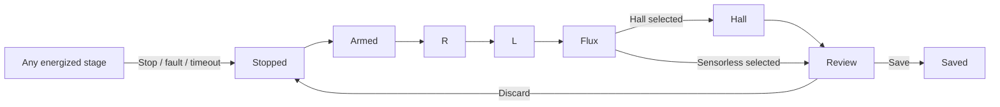

# Motor setup wizard and commissioning architecture

For the current operator workflow, see [Motor commissioning](../commissioning.md).

Status: protocol 16 wizard and aggregate Save implemented. Hall and sensorless
installation, persistence and reload verified on MK5 (2026-11-12). The wizard requires explicit DC source limits before it
can energize a motor. Commissioning uses a temporary device-owned control
session. A successful session produces a motor model and a proposed drive
limit for review.

## Wizard

| Step | What the operator sees and does |
| --- | --- |
| Controller | Connect, identify the controller, and check that it is stopped. Show the actual blocker if it has faults or its board/current-sense calibration is unavailable. |
| Power source | Enter **Input current limit (A)** and **Regenerative current limit (A)** for the DC bus. Both choices are required. **No regeneration (0 A)** is an explicit choice. Show previously saved values as suggestions. |
| Motor | Pick the closest named motor class from the preset list. Confirm pole pairs and Hall or sensorless operation. Advanced settings include a lower test-current ceiling for diagnostics. |
| Run detection | Review the source limits and confirm that the motor can spin freely. Show the current stage, measured or estimated DC current, and any limit reducing excitation. Keep Stop available throughout. |
| Review and save | Show R, Ld/Lq, flux, Kv, Hall result, and the proposed and effective motor current limits. Default drive mode is **Auto**. **Override** exposes the drive-current field here. **Save setup** installs and persists the reviewed setup. **Finish without saving** leaves the controller stopped. |

The two source currents are unsigned magnitudes. Zero return current means
no commanded energy return. Blank means undecided. The draw limit must be
positive for an energized test. The UI confirms both choices before
advancing, including for a repeat detection. The CLI prompts for the same
fields in interactive mode. A non-interactive invocation requires both
values explicitly, even when a setup already exists.

```text
Power source
Input current limit (A)        [                 ]
Regenerative current limit (A) [                 ]
                               [ No regeneration (0 A) ]
                               [ Back ] [ Continue ]
```

The power step describes the source that is physically connected. Saving
the setup also saves those limits. A standalone power settings screen changes
them when swapping from a bench supply to a battery. It can reuse the motor
calibration. Battery and regen capability may differ with the BMS and state
of charge.

## Data model

| Data | Owner and lifetime |
| --- | --- |
| Board calibration and inverter protection | Board-specific. ADC offsets and scaling, voltage/thermal protections, and the independent overcurrent limit survive a motor change. A stricter explicitly configured bench protection also remains in effect. |
| `PowerSourceLimits` | Validated positive input current and nonnegative regenerative current, in amperes. Confirmed for each run, saved for the installed setup only on Save. Zero return is a real value in the firmware contract. |
| Motor class | A typed preset shared by firmware, GUI and CLI. It supplies the loss budget and default speed and pole count. The normal flow passes a class ID. |
| `CommissioningSession` | Owns an immutable snapshot of source limits, class, pole pairs, requested sensor mode and optional test ceiling. The firmware checks all fields before arming. |
| Detection result | Candidate R, Ld/Lq, flux, Hall geometry when requested, and the estimated motor current rating. Retain achieved excitation and any active limit for each stage. Candidate validity is tied to the session and controller. |
| `DriveSetup` | Measured motor model, Hall or sensorless selection, source limits and a drive current choice of Auto or Override. Auto uses the estimated rating subject to the inverter envelope and its required overcurrent headroom. |

Keep the raw thermal estimate and the effective drive limit distinct.
For example, a 35 A estimate can coexist with a 30 A inverter trip and an
effective drive ceiling of about 23 A at the current 1.3× headroom. Override
still respects the inverter envelope. A motor-class budget is an estimate
from the selected class and the measured R. It does not establish a
continuous-current rating by thermal test.

Use one versioned flash record for the installed setup so a power cut
cannot pair a newly saved motor with old Hall geometry or old source
limits. Keep board calibration in its own record. Read legacy motor,
Hall, and limit groups as a fallback when the installed-setup record is
absent. Require explicit source choices when recommissioning a legacy setup.
Treat legacy unlimited source values as unset in the wizard. Prepare and
validate the full record, reserve the installation revision, persist while
stopped, and acknowledge Save after the device has installed that revision.
Verify old-or-new recovery and idempotent Save with power loss injected at
the flash boundaries.

## Firmware session



The host library owns R → L → flux → Hall ordering; CLI and GUI share it.
The device owns each measurement's authority, temporary constraints, bounded
execution and cleanup. `detect all` composes the same individual commands;
it does not require an autonomous sequence on the MCU. Reconnection can
query the retained operation without resubmitting a new measurement.

Reuse the existing actuation ownership and stopped-install paths. Bind each admitted operation to the existing detection guard. Feed a
temporary commissioning envelope to the current and voltage actuation paths.
The envelope combines the inverter protection, confirmed source limits,
class-derived excitation and the optional diagnostic cap. It excludes the
previous motor's thermal estimate and drive torque limit. Drop the envelope
on every exit path. The Hall step produces a candidate geometry, which is
published as part of Save. The flux step can use raw Hall transitions for
coast timing independently of the previous Hall table.

Use typed Ergot messages for Start, Stop, status and Save with a session ID
and request identity. Progress is low-rate. Bench captures retain native
fast telemetry and record stage boundaries by sample sequence. Captures and
progress share the current transport, with Stop and its acknowledgement
retaining priority.

## Enforcing the source limits

The current drive-mode bus clamp uses an estimate based on q-axis
modulation. The commissioning paths include d-axis holding current and
direct-voltage HFI. A commissioning power constraint must cover all three
before the wizard offers an energized run.

- Derive signed DC current from the board's bus-current measurement where
  available. For MK5, qualify a two-axis estimate from phase currents and
  time-aligned applied voltage or PWM duty, with margin verified against
  external measurements. Label estimated current in the UI. Keep VBUS and
  phase overcurrent protection independent of the estimate. Prepare the
  envelope outside the ADC ISR and measure control-loop timing with the
  per-cycle limit active.
- Check the power envelope before applying excitation. In a steady
  current step, reduce the target if the source limits it. In an HFI or
  pulse measurement, size the packet before arming it. If protection clips
  or interrupts a packet, discard that measurement window. Surface a
  source-limited failure when the attainable excitation is too small.
- For a source that cannot sink current, use a bounded spin-up and coast
  for the flux step. Keep the spin target inside a board-qualified
  envelope for back-EMF and VBUS headroom. Preserve an independent
  overvoltage stop. Verify transient bus behavior on the bench before
  treating the estimator as suitable for this source class.

Existing integration points are
[`DetectionActiveGuard`](../../oxifoc-core/src/state.rs),
[`detect_server`](../../oxifoc-core/src/runtime/detect.rs),
[`FocDriver` modes](../../oxifoc-core/src/motor/foc_driver/modes.rs),
[bus and inverter protection](../../oxifoc-core/src/motor/foc_driver/protection.rs),
and [configuration storage](../../oxifoc-core/src/storage.rs).

The core owns the validated request, preset catalog, result and Ergot
contract. The detection runtime owns session progression and adapts the
existing measurement functions. The FOC driver owns current and power
enforcement. The board backend supplies a measured or qualified estimated
power signal. The host library owns transport and capture plumbing. Slint
and CLI gather the request and display the same device state. The flash
task persists the installed setup through the existing stopped-write path.

## Implementation order

### Verified foundation (2026-11-11)

`PreparedCommissioning` installs a temporary inverter/source envelope at an
acknowledged ISR boundary. Old ride and motor limits do not constrain it.
Stop, errors, cancellation and conflicting configuration changes disarm and
restore the old limits. HFI packets carry the detection generation too.
Protocol version is 12; host and firmware must be updated together.

The source monitor uses both current axes and delayed final PWM duties.
Its 2 ms low-pass and 1 mA estimator deadband reject DC-link exchange and
startup noise; target grants retain an exact zero-regeneration bound. It is
an estimated inverter-input current, not independently measured PSU current.
Voltage packets are aborted rather than silently clipped. Failed measurements
whose current target was source-constrained report `SourceLimited`.

MK5/H5055, class Medium Outrunner (120 W), source 5/0 A, inverter trip 30 A:
R 63.160 mΩ, Ld/Lq 30.667/49.926 µH, flux 3.978 mWb, Kv 197.98; Hall passed.
Measured peaks were Id 16.37 A (R), 11.34 A (L packets), Iq 16.31 A (flux),
Id 12.28 A (Hall). Four captures contain 646,550 samples at 20,004.27 Hz with
zero gaps/drops. The prior 10 A ride limit was restored. Stop during L was
acknowledged in 8.63 ms and did not resume; its 10,518 samples had no gaps.
With input constrained to 0.05 A, R detection returned `SourceLimited`:
130,581 samples without gaps, peak Id 3.595 A, offline 2-ms filtered DC
estimate peak 0.05045 A. Input/regen limits were restored to 5/0 A in RAM.
No setup Save was issued. Legacy Hall installation still changes RAM, and
boot current-offset calibration also refreshes RAM.

Artifacts and plots:
`/home/okhsunrog/tmp_zfs/codex_tmp/oxifoc-commissioning-20261111/`.
Regression: `just test-stop-bridge <capture.parquet> <measured_R_ohm>`.

At that milestone, explicit session plans and atomic Save were still pending.
Individual diagnostic commands consume configured finite source limits.
Full wizard sessions now carry confirmed source limits (see protocol 15 below). The virtual
backend runs a separate measurement simulation and does not yet exercise
this ISR envelope; unit tests of the driver are not end-to-end simulation
acceptance. External DC-current comparison, disconnect coverage and ISR
timing qualification remain necessary.

### Operation contract (implemented, protocol 14)

The session state machine is now the only admission/replay owner behind
`DetectEndpoint`. `Inspect` reads identity; `Open` uses expected-session CAS
plus a client key. Repeating Open returns the same session; another client's
key cannot borrow that acknowledgement. F405 boot IDs use 64 hardware-RNG bits
(collision probability is nonzero, not a persistent exactly-once journal).
Start/Status/Cancel carry boot/session/sequence identity. Terminal outcomes
include failures and cancellation. Older sequence numbers remain retired even
when their result has been replaced. Reset invalidates the old boot identity.
A changed payload under an existing key is rejected. Non-finite wire input is
rejected before admission. Sequence/session counters cannot wrap.

Status/cancel are serviced during measurement. Cancel revokes the matching
ISR generation immediately, replies Cancelling, and becomes terminal Cancelled
only after acknowledged cleanup. A cancellation received before Start closes
that sequence without energizing. An obsolete cancellation cannot affect a
new operation. Each operation has a 65-second device deadline. Transport timeout
is reported as outcome unknown; it does not implicitly start another operation.
Opening a replacement session requires the current operation to be terminal.

Host `new_detection` prepares an identity without starting the motor. Retain
that Measurement for retries. The existing high-level Detect API waits through
Running/Cancelling; `measurement_request` exposes the protocol for other clients.
CLI prints IDs at start and stores them in Parquet metadata. Recovery commands:
`measurement inspect`, `measurement status <boot> <session> <sequence>`, and
`measurement cancel <boot> <session> <sequence>` (poll until terminal).
Ordinary `detect all` and individual steps use this protocol automatically.

MK5 regression: addressed cancellation during L, duplicate and conflicting
requests, cancellation before Start, result retirement and session replacement.
22,994 Packed28 samples at 20,004.27 Hz with zero gaps/drops; one PWM-enabled
interval only. Terminal cancellation was observed after 61.67 ms, including host
polling and cleanup (not an ISR stop-latency measurement). After reset, old
Start/Status/Cancel were all rejected with WrongSession. Artifacts:
`/home/okhsunrog/tmp_zfs/codex_tmp/oxifoc-operation-contracts-20261111/`.
Regression recipes: `test-stop-bridge`, then after reset `test-replay-bridge`
with the generated `.request.json` file.

Final-build repeat: 22,418 lossless records; terminal cancellation observed in
29.96 ms. Old-boot rejection passed again after reset. Ordinary release-CLI
`detect all` then completed R/L/flux/Hall with 650,627 native-rate records and
zero gaps, producer drops or host drops. R 63.283 mΩ, Ld/Lq 32.142/50.980 µH,
flux 4.003 mWb, Kv 196.75, Hall valid. No flash Save; final state Stopped,
fault_count 0. Core validation: 718 passed, 2 ignored. Host CLI/GUI/virtual
checks and the MK5 release build passed.

### Immutable commissioning plan (implemented, protocol 15)

The motor preset catalog lives in core. Full detection opens one session with
`CommissioningPlan`: typed class, explicit DC source limits, pole pairs, flux
speed, Hall selection and optional diagnostic current ceiling. The device
rejects changed conditions under the same Open key and changed stage conditions.
Any configuration revision change prevents admission of the next stage; retained
terminal results remain replayable. Individual diagnostic sessions remain
available and use configured source limits. R/L/flux/Hall sequencing stays in
host-lib; each stage receives its preallocated operation identity.

Hall returns the complete candidate table and edge geometry. Its former privileged
installation token/path was removed. Measurement cannot alter the live table,
revision, motor model or stored source limits. GUI cancellation addresses the
current operation, including a cancel-before-Start race. CLI and GUI require
explicit source input for full detection; the GUI has a dedicated source page.
Non-interactive example: `detect all --motor-class medium-outrunner
--input-current-a 5 --regen-current-a 0 --record <new-directory>`.

MK5/H5055: one session, operations 1–4, source 5/0 A, class Medium Outrunner,
no manual phase-current ceiling. R 63.386 mΩ; Ld/Lq 31.091/50.514 µH;
flux 3.970 mWb; Kv 198.38; valid Hall geometry returned. Peaks of measured dq
current: R 16.30 A, L 11.37 A, flux 16.34 A, Hall 12.25 A. All 653,492 samples
at 20,004.27 Hz arrived without gaps or producer/host drops; sequence validation
accounts for the 16-bit wrap. The full config dumps before/after are identical,
including Hall data and revision. Final Stopped, faults 0, FET 32.1 °C.
No Apply or Persist was sent. The waveform and source-page previews were viewed.

Artifacts: `oxifoc-operation-contracts-20261111/wizard-session*`,
`wizard-config-{before,after}.json`, `wizard-analysis.json`, `wizard-source.png`
under `/home/okhsunrog/tmp_zfs/codex_tmp/`. Core: 720 passed, 2 ignored;
minimal core and CLI/GUI/virtual checks pass; 41 host-lib tests pass; MK5 release flashed and verified.
Addressed cancellation/retry regression adds 22,414 lossless records; terminal
cancellation observed in 30.29 ms. A fresh configuration can use explicit session
source limits without first persisting legacy CurrentLimits; board protection
still bounds excitation. After flashing the final build and resetting, old-boot
Start/Status/Cancel were rejected again without energizing the motor.

### DriveSetup value boundary (2026-11-12)

Core now defines explicit `Feedback::{Hall, Sensorless}`, `DriveCurrent::{Auto,
Override}`, and `DriveSetup`. Validation produces a non-deserializable
`ValidatedDriveSetup` using controller-owned protection. Auto separates the raw
thermal estimate from the effective inverter-bounded current; overrides above
either bound are rejected. The candidate does not carry board calibration or
change the independent trip. A new setup resets inherited dissipative braking
and unmeasured fundamental inductances. Host-lib constructs the candidate from
this detection; CLI JSON includes it for review. This milestone introduced the value boundary later used by the installer.


### Frozen aggregate record and interrupted-write tests (2026-11-12)

`drive_setup::record::SetupRecord::V1` owns a frozen primitive layout for the
whole motor, feedback geometry, source limits and Auto/Override choice. It does
not embed evolving config structs, board protection or duplicate derived motor
ratings. Decoding revalidates against the actual controller protection.
Truncated payloads and unknown versions are rejected. Roundtrip tests cover Hall
and sensorless, Auto and Override, and a reduced protection limit after reboot.

The sequential-storage mock test interrupts replacement at 1,024 byte-countdown
positions across 12 successive append/page positions (12,288 attempts). Reopening
with a fresh cache recovered the complete old or new setup in every case; both
interrupted and successful writes occurred. This is simulated flash acceptance,
not a physical power-cut test. The regression now exercises the installed
record under its actual storage key.


### Complete wizard and aggregate Save (protocol 16)

Save verifies that the supplied motor parameters, Hall result and source limits
match the current completed measurement session and its original configuration
revisions. The operator can choose Auto or a bounded Override. The device
reserves a stopped installation, writes the versioned aggregate, then installs
the prepared model at the ISR boundary. The acknowledgement means that both
steps completed. Repeated requests with the same key and payload replay their
answer. A changed payload with that key is rejected. After a flash write with
uncertain outcome or failed live installation, the drive remains inhibited
until recovery or restart.

Boot reads legacy motor, Hall and current-limit groups when the installed record
is absent. A saved setup takes precedence for all three groups together. A
sensorless setup explicitly clears the Hall calibration and selects Observer.
Individual config saves update only the requested group in the durable aggregate;
unsaved changes to other groups do not leak into that record. Reset advances
revisions so a pre-reset review cannot be saved afterward.

CLI `detect all` shows the reviewed setup and effective current. Interactive
runs can confirm Save after reviewing the result. Non-interactive runs require
`--apply` to save. `--drive-current-a` selects Override. The GUI has a Review
page with the confirmed source, measured values, Auto ceiling, Override field,
Save and Finish without saving. Both use the same host-lib Save path.

MK5/H5055, 24 V, input 5 A / regeneration 0 A: legacy config loaded after the
firmware update (current offsets are recalibrated at boot). A Hall setup with
Auto, a sensorless replacement with Override 10 A and a final Hall setup with
Auto were saved and read back after reset. An independent source-limit edit to
4.5 A survived reset and preserved the motor and Hall data. Restoring 5 A and
resetting returned the complete final config. Final Hall/Stopped, faults 0,
configured trip 30 A, effective phase limit 23.08 A, thermal estimate 35.53 A.
The three successful runs recorded 1,597,970 native-rate samples with zero loss.
They used the Advanced 10 A measurement ceiling. Earlier runs aborted on
`SourceLimited` or a host capture overflow before saving. Neither source
protection nor the inverter trip was relaxed.

Artifacts live under
`/home/okhsunrog/tmp_zfs/codex_tmp/oxifoc-operation-contracts-20261111/`
(`atomic-*` and `setup-review.png`). The GUI was compiled and its review
screen rendered. The actual device Save path was exercised through the CLI.
TCP simulation additionally checked exact Save replay, changed-payload
rejection and revision/persistence acknowledgements for all three groups.

### Source limit at the end of Hall

MK5/H5055, 24 V, Medium Outrunner, 5 A input and 0 A regen, no Advanced
ceiling. Four full reruns (three with a temporary CCM trace, one with the
normal image) stopped on `SourceLimited` during the inductance step. Two
standalone Hall runs repeated the original full sequence's Hall request
(120 W, 63.703 mΩ) and reproduced the stop during ramp-down at a 0.354 A
request. Both retained every Packed28 sample at 20,004 Hz.

The exact 2 ms filtered inverter-input estimate was −1.001 and −1.003 mA at
the −1 mA trip threshold. The equivalent estimates from phase-voltage ADC and
phase currents were −0.625 and −0.596 mA. Both estimates indicate a small
reverse-power transient, with disagreement in magnitude. Neither measures
current in the supply lead. Vbus showed no repeatable rise above its sample
scatter. The grant calculation also clips the d-axis target to zero when
the applied d-axis modulation projects negative power at zero regen.

The temporary instrumentation recorded the last 256 source checks in CCM
and was read over SWD after Stop. The usual stream and limit logic were used.
Captures, exact trace, comparison plots and the diagnostic patch are under
`/home/okhsunrog/tmp_zfs/codex_tmp/oxifoc-commissioning-source/`
(`hall-CyegD0`, `hall-BeR0j1`). The normal image was restored and verified.
The saved configuration matched after boot offset recalibration, with Hall
selected, motor stopped and zero faults.

VESC 7.00 (`1ad6eab3`, recording patches), same H5055 and MK5. The native
E-Skate / Medium Outrunner wizard completed with Hall and no current fault.
Bench settings were 5 A input, −2 mA in the command (zero selects −60 A),
22/23 V regen cutoff for an effective zero at 24 V, and a 26 V trip.
The last R plateau averaged 20.10 A Iq. L used bursts up to 6.90 A dq.
Flux held about 14.2 A Iq. Hall held 11.88 A Id, close to OxiFOC's 11.80 A.
VESC disabled PWM directly at 11.85 A Id and Vbus rose by about 0.16 V over
the next few milliseconds. This includes load removal and does not establish
supply-lead regeneration. VESC limits Iq from the input current limits and
has no equivalent milliampere trip on the signed inverter estimate.
R/L and Hall were complete at native 5 and 15 kHz. The run lost 29,871 of
465,478 samples overall, including 23,105 during 20 kHz flux excitation.
The comparative plots and raw data are in
`/home/okhsunrog/tmp_zfs/codex_tmp/vesc-h5055-source-limit/run-ErHWfO/`.
The OxiFOC image and saved configuration were verified after restoration.

The shared L/Hall release now lowers the stationary current with a cubic
envelope at 1 ms command intervals, retains the PI, and waits for a fresh
sample below 0.5 A dq before requesting Stop. The source guard and the 0 A
regen setting were used unchanged. Three full Medium Outrunner runs at
5 A / 0 A without Advanced completed with zero faults and 1,951,933
Packed28 samples at 20,004.272 Hz without loss. Last active dq magnitudes
across the L and Hall exits were 0.23–0.59 A. Results were not applied.

OxiFOC measured R 63.85–65.63 mΩ, Ld 30.75–32.59 µH, Lq 49.79–51.45 µH
and λ 3.997–4.012 mWb. VESC measured 62.68 mΩ, 35.13 µH, 59.62 µH and
4.052 mWb. Positive Hall order was 4→5→1→3→2→6 on both firmwares, with
centers within 2.01 electrical degrees. OxiFOC also measured entry
boundaries. Captures, release plots and per-sector results are under
`/home/okhsunrog/tmp_zfs/codex_tmp/oxifoc-stationary-release/`.
