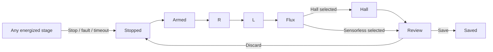

# Motor setup wizard and commissioning architecture

Status: wizard/session design; temporary per-step envelope implemented and
bench-tested (2026-11-11). The wizard requires explicit DC source limits before it
can energize a motor. Commissioning uses a temporary device-owned control
session. A successful session produces a motor model and a proposed drive
limit for review.

## Wizard

| Step | What the operator sees and does |
| --- | --- |
| Controller | Connect, identify the controller, and check that it is stopped. Show the actual blocker if it has faults or its board/current-sense calibration is unavailable. |
| Power source | Enter **Input current limit (A)** and **Regenerative current limit (A)** for the DC bus. Both choices are required. **No regeneration (0 A)** is an explicit choice. Show previously saved values as suggestions. |
| Motor | Pick the closest named motor class from the preset list. Confirm pole pairs and Hall or sensorless operation. Advanced settings include a lower test-current ceiling for diagnostics. |
| Run detection | Review the source limits and confirm that the motor can spin freely. Show the current stage, measured or estimated DC current, and any limit reducing excitation. Keep Stop available throughout. |
| Review and save | Show R, Ld/Lq, flux, Kv, Hall result, and the proposed and effective motor current limits. Default drive mode is **Auto**. **Override** exposes the drive-current field here. **Save setup** installs and persists the reviewed setup. **Finish without saving** leaves the controller stopped. |

The two source currents are unsigned magnitudes. Zero return current means
no commanded energy return. Blank means undecided. The draw limit must be
positive for an energized test. The UI confirms both choices before
advancing, including for a repeat detection. The CLI prompts for the same
fields in interactive mode. A non-interactive invocation requires both
values explicitly, even when a setup already exists.

```text
Power source
Input current limit (A)        [                 ]
Regenerative current limit (A) [                 ]
                               [ No regeneration (0 A) ]
                               [ Back ] [ Continue ]
```

The power step describes the source that is physically connected. Saving
the setup also saves those limits. A standalone power settings screen changes
them when swapping from a bench supply to a battery. It can reuse the motor
calibration. Battery and regen capability may differ with the BMS and state
of charge.

## Data model

| Data | Owner and lifetime |
| --- | --- |
| Board calibration and inverter protection | Board-specific. ADC offsets and scaling, voltage/thermal protections, and the independent overcurrent limit survive a motor change. A stricter explicitly configured bench protection also remains in effect. |
| `PowerSourceLimits` | Validated positive input current and nonnegative regenerative current, in amperes. Confirmed for each run, saved for the installed setup only on Save. Zero return is a real value in the firmware contract. |
| Motor class | A typed preset shared by firmware, GUI and CLI. It supplies the loss budget and default speed and pole count. The normal flow passes a class ID. |
| `CommissioningSession` | Owns an immutable snapshot of source limits, class, pole pairs, requested sensor mode and optional test ceiling. The firmware checks all fields before arming. |
| Detection result | Candidate R, Ld/Lq, flux, Hall geometry when requested, and the estimated motor current rating. Retain achieved excitation and any active limit for each stage. Candidate validity is tied to the session and controller. |
| `DriveSetup` | Measured motor model, Hall or sensorless selection, source limits and a drive current choice of Auto or Override. Auto uses the estimated rating subject to the inverter envelope and its required overcurrent headroom. |

Keep the raw thermal estimate and the effective drive limit distinct.
For example, a 35 A estimate can coexist with a 30 A inverter trip and an
effective drive ceiling of about 23 A at the current 1.3× headroom. Override
still respects the inverter envelope. A motor-class budget is an estimate
from the selected class and the measured R. It does not establish a
continuous-current rating by thermal test.

Use one versioned flash record for the installed setup so a power cut
cannot pair a newly saved motor with old Hall geometry or old source
limits. Keep board calibration in its own record. Read legacy motor,
Hall, and limit groups as a fallback when the installed-setup record is
absent. Require explicit source choices when recommissioning a legacy setup.
Treat legacy unlimited source values as unset in the wizard. Prepare and
validate the full record, reserve the installation revision, persist while
stopped, and acknowledge Save after the device has installed that revision.
Verify old-or-new recovery and idempotent Save with power loss injected at
the flash boundaries.

## Firmware session



The device owns the entire sequence, from an acknowledged Start through the
final Stop. GUI and CLI render the same stage and result messages. A
keyed Start returns the existing session on retry. An acknowledged Stop
invalidates the session's authority to enqueue excitation, including any
armed HFI packet. A device-side deadline and loss of the host session
terminate excitation. Reconnection reads status or a completed result.
A new explicit Start is required to energize again.

Reuse the existing actuation ownership and stopped-install paths. Extend
the scope of the existing detection guard to the whole session. Feed a
temporary commissioning envelope to the current and voltage actuation paths.
The envelope combines the inverter protection, confirmed source limits,
class-derived excitation and the optional diagnostic cap. It excludes the
previous motor's thermal estimate and drive torque limit. Drop the envelope
on every exit path. The Hall step produces a candidate geometry, which is
published as part of Save. The flux step can use raw Hall transitions for
coast timing independently of the previous Hall table.

Use typed Ergot messages for Start, Stop, status and Save with a session ID
and request identity. Progress is low-rate. Bench captures retain native
fast telemetry and record stage boundaries by sample sequence. Captures and
progress share the current transport, with Stop and its acknowledgement
retaining priority.

## Enforcing the source limits

The current drive-mode bus clamp uses an estimate based on q-axis
modulation. The commissioning paths include d-axis holding current and
direct-voltage HFI. A commissioning power constraint must cover all three
before the wizard offers an energized run.

- Derive signed DC current from the board's bus-current measurement where
  available. For MK5, qualify a two-axis estimate from phase currents and
  time-aligned applied voltage or PWM duty, with margin verified against
  external measurements. Label estimated current in the UI. Keep VBUS and
  phase overcurrent protection independent of the estimate. Prepare the
  envelope outside the ADC ISR and measure control-loop timing with the
  per-cycle limit active.
- Check the power envelope before applying excitation. In a steady
  current step, reduce the target if the source limits it. In an HFI or
  pulse measurement, size the packet before arming it. If protection clips
  or interrupts a packet, discard that measurement window. Surface a
  source-limited failure when the attainable excitation is too small.
- For a source that cannot sink current, use a bounded spin-up and coast
  for the flux step. Keep the spin target inside a board-qualified
  envelope for back-EMF and VBUS headroom. Preserve an independent
  overvoltage stop. Verify transient bus behavior on the bench before
  treating the estimator as suitable for this source class.

Existing integration points are
[`DetectionActiveGuard`](../../oxifoc-core/src/state.rs),
[`detect_server`](../../oxifoc-core/src/runtime/detect.rs),
[`FocDriver` modes](../../oxifoc-core/src/motor/foc_driver/modes.rs),
[bus and inverter protection](../../oxifoc-core/src/motor/foc_driver/protection.rs),
and [configuration storage](../../oxifoc-core/src/storage.rs).

The core owns the validated request, preset catalog, result and Ergot
contract. The detection runtime owns session progression and adapts the
existing measurement functions. The FOC driver owns current and power
enforcement. The board backend supplies a measured or qualified estimated
power signal. The host library owns transport and capture plumbing. Slint
and CLI gather the request and display the same device state. The flash
task persists the installed setup through the existing stopped-write path.

## Implementation order

### Verified foundation (2026-11-11)

`PreparedCommissioning` installs a temporary inverter/source envelope at an
acknowledged ISR boundary. Old ride and motor limits do not constrain it.
Stop, errors, cancellation and conflicting configuration changes disarm and
restore the old limits. HFI packets carry the detection generation too.
Protocol version is 12; host and firmware must be updated together.

The source monitor uses both current axes and delayed final PWM duties.
Its 2 ms low-pass and 1 mA estimator deadband reject DC-link exchange and
startup noise; target grants retain an exact zero-regeneration bound. It is
an estimated inverter-input current, not independently measured PSU current.
Voltage packets are aborted rather than silently clipped. Failed measurements
whose current target was source-constrained report `SourceLimited`.

MK5/H5055, class Medium Outrunner (120 W), source 5/0 A, inverter trip 30 A:
R 63.160 mΩ, Ld/Lq 30.667/49.926 µH, flux 3.978 mWb, Kv 197.98; Hall passed.
Measured peaks were Id 16.37 A (R), 11.34 A (L packets), Iq 16.31 A (flux),
Id 12.28 A (Hall). Four captures contain 646,550 samples at 20,004.27 Hz with
zero gaps/drops. The prior 10 A ride limit was restored. Stop during L was
acknowledged in 8.63 ms and did not resume; its 10,518 samples had no gaps.
With input constrained to 0.05 A, R detection returned `SourceLimited`:
130,581 samples without gaps, peak Id 3.595 A, offline 2-ms filtered DC
estimate peak 0.05045 A. Input/regen limits were restored to 5/0 A in RAM.
No setup Save was issued. Legacy Hall installation still changes RAM, and
boot current-offset calibration also refreshes RAM.

Artifacts and plots:
`/home/okhsunrog/tmp_zfs/codex_tmp/oxifoc-commissioning-20261111/`.
Regression: `just test-stop-bridge <capture.parquet> <measured_R_ohm>`.

Still pending: full firmware-owned sequence/candidate/atomic Save and both
wizard clients. Legacy detection currently consumes explicitly configured
finite source limits, not a freshly confirmed source step. The virtual
backend runs a separate measurement simulation and does not yet exercise
this ISR envelope; unit tests of the driver are not end-to-end simulation
acceptance. External DC-current comparison, disconnect coverage and ISR
timing qualification remain necessary.

### Remaining sequence

1. Add the typed source limits and temporary device envelope. Prove
   enforcement in current, voltage packet, and spin/coast paths. Exercise
   Stop, disconnect, low source ceilings and zero regen in simulation and on
   the MK5 with an independent DC current reference.
2. Move orchestration and result review into the device session. Add
   stopped atomic Save and legacy readback. Verify that an old drive limit
   cannot change a new motor's run and that inverter protection still can.
3. Bind one host workflow to the Slint wizard and CLI. Test missing source
   input, explicit zero, reconfiguration of a saved source, sensorless
   installation after a Hall motor, and full H5055 detection with lossless
   20 kHz capture before enabling the normal wizard path.
