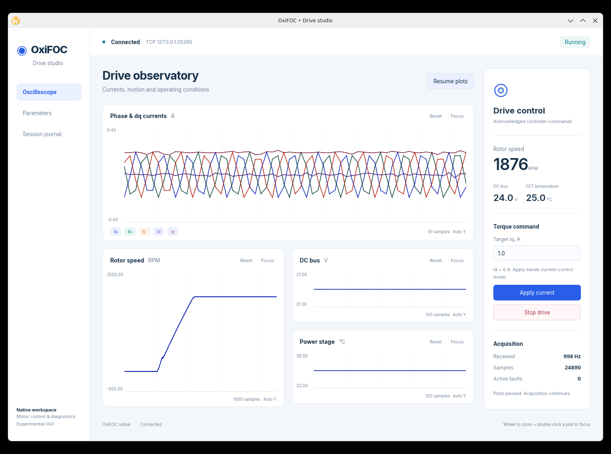

# OxiFOC Drive studio

Experimental Dioxus Native frontend. Uses `oxifoc-host-lib` directly and the shared
`oxifoc-plot` WGPU renderer. No generated telemetry or simulator-specific protocol.
Opens a connection page with BLE, TCP/UDP and desktop USB/serial/RTT options.
The shared connection flow requests 100 Hz fast telemetry.

From the repository root, start the existing virtual controller:

```sh
nix develop -c cargo run -p oxifoc-virtual -- --transport tcp --port 2025
```

Then start the GUI:

```sh
nix develop -c cargo run --manifest-path oxifoc-host-dioxus/Cargo.toml --release --locked
```

Choose Network, enter `127.0.0.1:2025`, then Connect. `OXIFOC_TCP_HOST` and
`OXIFOC_TCP_PORT` prefill the form without automatically connecting.
`--catalogue` opens the shared [component catalogue](../oxifoc-ui/README.md);
`--compact` starts a narrow window for inspecting the connection layout.
Apply current sends
an acknowledged current-control command. Stop sends acknowledged Stopped.
Pausing freezes chart history while receiving continues. Wheel zoom anchors at
the pointer when paused. Currents use the controller's calibration through
`build_enrich_ctx`, exactly as the Slint frontend does.

The initial slice includes phase/dq currents, RPM, bus voltage, FET temperature,
channel toggles, plot focus, motor parameter editing and session events.
Parameters reads the motor model when first opened and reloads it after
reconnecting. Apply to RAM uses the revision and boot epoch from the read.
Save to flash persists the acknowledged revision.
Commissioning workflows are planned. Discovery and the connection page use
the shared `oxifoc-ui` and `oxifoc-host-dioxus-ui` crates.

This crate has its own workspace/lockfile to isolate experimental Dioxus/Blitz
patches from the established Slint and firmware dependency graph. Shared crates
are path dependencies, not copies. The native adapter is vendored from Dioxus
97adf7915e1adfef4e2da436c9bd0b6add0dfa39 with Winit beta.4 compatibility; Blitz is
4f61cffacee50fe4f944ebe9d0470d9a5d3997e0 and AnyRender is
97d06af9fe8fe1c2cc5916c6d09fba10774d86a6. Vendored MIT license is included.

The explicit `--verify-virtual` probe requires a dedicated simulator at loopback
port 25265. It verifies identity, motor parameter readback, current command,
calibrated samples and motion, and sends Stopped before closing the host.



## Validation, 2026-11-15

Release build and the viewport tests pass. Shared plotting tests include actual
GPU readback; the Slint frontend passes `cargo check` after the migration.

The dedicated virtual-controller probe received 2,840 samples, read motor
parameters at revision 0, observed 24 V and 1,876 RPM after an acknowledged 1 A
current command, then received an Applied/Stopped acknowledgement.

In an isolated KWin window on Intel Arc/Mesa, exercised Apply current, Stop,
pause, wheel zoom (1000 → 549 and 61 samples), focus/Escape, parameter readback,
and session events. Restarting the virtual controller showed Offline, disabled
commands, then reconnected and resumed acquisition. All four plots fit the
1440×1000 client window. The saved screenshot contains received telemetry.

This is the first working frontend slice, not feature parity with the Slint GUI.
Narrow-window layouts, other operating systems, physical devices and accessibility
were outside the scope of this run. No physical controller was used. Test
processes were stopped afterward.
