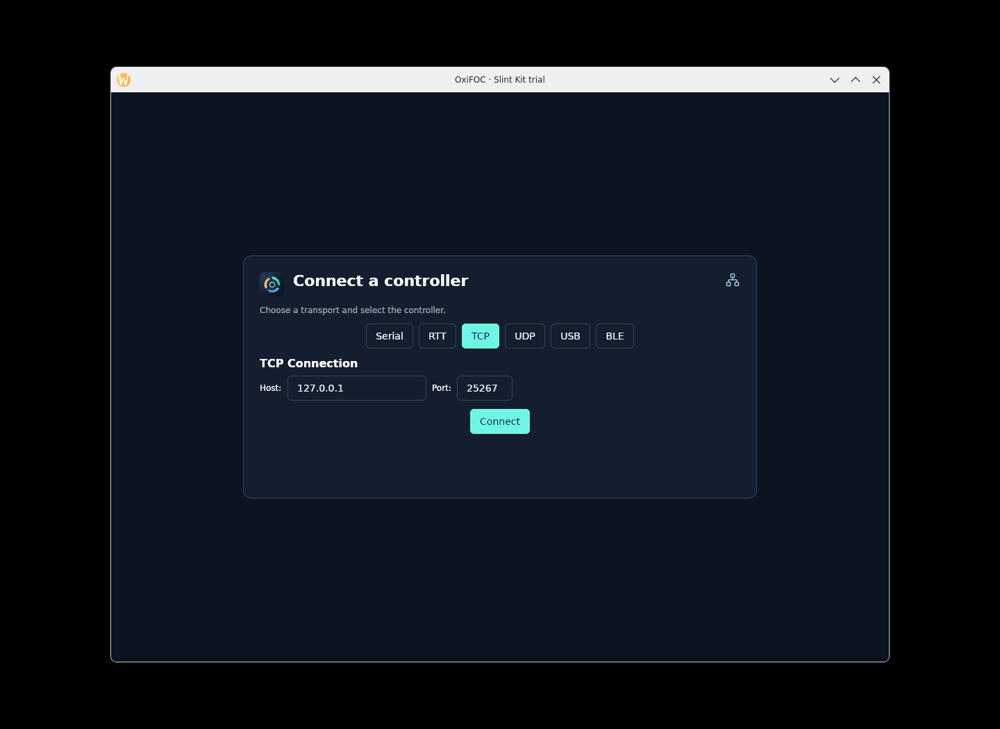
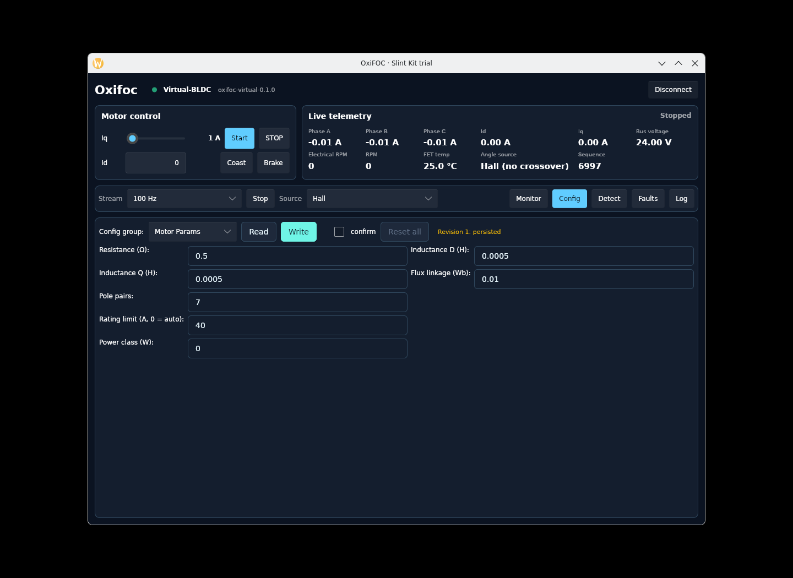

# OxiFOC Slint frontend — component-library trial

The connection page and configuration editor now use Slint Kit 0.8.0 through
small product adapters in `ui/oxifoc-kit.slint`. They remain wired to the existing
host runtime and configuration handlers. Discovery results, controller parameters
and telemetry are real; no demonstration values enter these screens.

The remaining monitor, detection, fault and log screens retain their existing
standard widgets. This is an adoption trial, not a complete visual redesign.
Slint remains at 1.18.1. Slint Kit's runtime and build helper are pinned to the
same 0.8.0 release; the helper uses experimental Slint module compilation.
`slint_kit::install` registers the required per-window services.

OxiFOC supplies a dark navy/turquoise `KitTheme` at startup, including text,
surface, border and primary-action colors. Current fonts are explicit DejaVu
Sans to keep the existing widgets and Kit controls consistent on Linux.
Lucide Slint is a build dependency and supplies the connection transport glyph.
The rotor mark uses the shared SVG asset. Kit's internal Lucide glyphs retain
its own representation; this trial does not replace those internals.

`OxiNumberField` keeps signed decimal/scientific notation editable and declares
a Kit pattern constraint. Inline pattern feedback did not appear in the manual
trial, including after blur and explicit `report-validity`; it is not qualified
yet. The existing Rust parsing and controller validation remain the confirmed
checks before a configuration write. The trial does not add parameter-specific
range declarations or a typed `FieldSpec` for every motor setting yet.

## Run

From the repository root:

```sh
nix develop -c cargo run -p oxifoc-host-slint --locked
```

For a dedicated virtual controller:

```sh
nix develop -c cargo run -p oxifoc-virtual -- --transport tcp --port 25267
OXIFOC_TCP_PORT=25267 nix develop -c cargo run -p oxifoc-host-slint --locked
```

The environment variable prefills TCP without connecting automatically.
The Nix shell includes FreeType for the Slint Skia runtime.

## Validation

Desktop build and actual virtual-controller TCP connection were exercised in
an isolated KWin session. Host editing, Tab traversal and Return activation of
Connect worked. Configuration Read populated the Kit fields from the controller;
invalid resistance text was rejected by the existing write handler. Scientific
notation `5e-1` was applied to the virtual controller as the existing 0.5-ohm
resistance; the controller acknowledged revision 1. No motor command was sent.

IME/safe areas, responsive mobile layout and assistive technology have not been
qualified for this integration. The monitor still has desktop minimum widths
and clips on a portrait phone; it needs a mobile layout. This trial does not
claim a performance or binary-size improvement. Slint Kit is GPL-3.0-or-later;
Lucide Slint is MIT/Apache-2.0 with ISC icon data; see the dependencies' notices.

## Android and BLE

Linux and Android use the same blec transport in `oxifoc-host-lib`. Android
passes its NativeActivity explicitly to the embedded Kotlin bridge so Scan can
request Nearby devices. The Android connection page starts with BLE and offers
only BLE, TCP and UDP. Serial, RTT and USB remain desktop-only.

Install the packaging fix for `usesPermissionFlags`, then build from the root
with Android SDK/NDK and Java available:

```sh
cargo install --git https://github.com/okhsunrog/cargo-rapk --rev 884cf3e2cdd406b862d0feebf8af0995b9b40774 --locked cargo-rapk
nix develop -c oxifoc-host-slint/build-android.sh
adb install --no-incremental -r target/debug/apk/oxifoc-slint.apk
```

The shared Android icon resources supply the launcher icon; Linux uses the
shared window icon and `com.oxifoc.studio.slint` desktop entry. Run
`packaging/linux/install-launchers.sh` after building the desktop binary.

On 2026-11-15, Linux Slint and Dioxus Native were exercised as BLE centrals
against `experiments/ble-android-peripheral`, backed by `oxifoc-virtual`.
Slint received approximately 100 samples/s with zero channel drops. On a Pixel
8 Pro, Slint's actual permission dialog, BLE scan, MTU 517, controller identity
and approximately 100 samples/s were observed against the Linux virtual bridge.
The Android handshake needed reconnect/retries before telemetry started; this
is not yet a clean first-connect acceptance. Dioxus Android also completed the
handshake after retries and negotiated 79 Hz in that run (not a throughput
benchmark). No motor command was sent. The diagnostic advertising app was then
stopped and removed; neither product frontend advertises.




