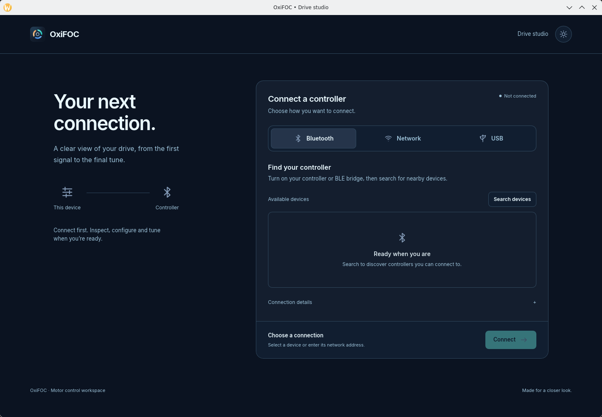
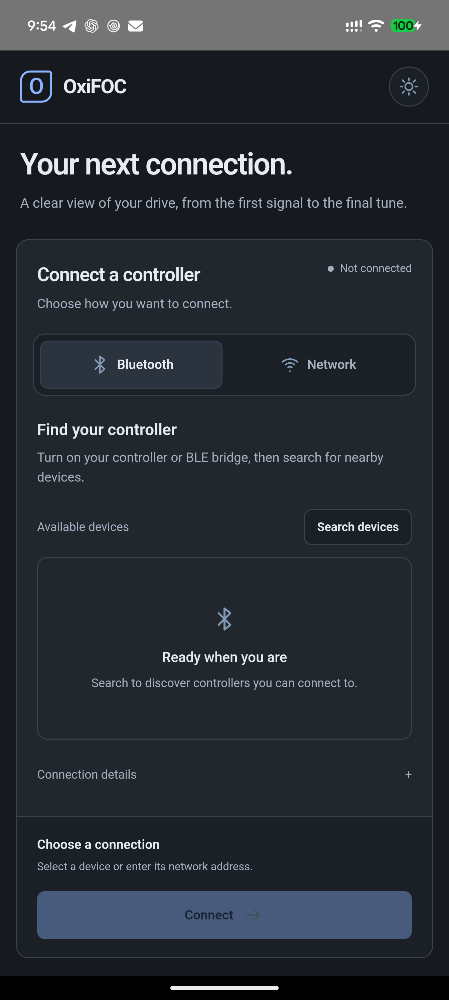

# OxiFOC UI

Shared Dioxus components, theme and adaptive connection page for Native/Blitz
and WebView hosts. This crate performs no discovery, connection or motor I/O.
The application supplies platform capabilities, form state, discovery results
and event handlers. Selected upstream source and retained licenses are recorded
in [UPSTREAM.md](UPSTREAM.md).

`oxifoc-host-dioxus-ui` owns the connection flow and the shared host runtime.
The Native launcher hands a confirmed session to its existing plot workspace;
the WebView/mobile launcher currently shows a read-only telemetry overview.

## Styles

```sh
cd oxifoc-ui
vp install
vp run build
```

Tailwind utilities and explicit component CSS compile into `assets/oxifoc.css`.
The generated file is committed and included by Rust, so normal Cargo builds
need no Node tooling. `vp run dev` watches the stylesheet. The optional Parcel
watcher install script is disabled; Tailwind's packaged platform binaries are
used. Fonts fall back from system Inter to Roboto and DejaVu Sans.

The shared styles avoid browser preflight and use semantic component classes
for theme values. Native compatibility needs testing at the pinned Blitz
revision: do not infer support from a WebView screenshot. In particular:

- SVG icons carry literal stroke colors, without CSS styling inside SVG.
- Scroll regions use `overflow: scroll`, rather than `overflow: auto`.
- The application viewport is an explicit scroll container; relying on body
  overflow left the Native catalogue clipped.
- Connection panels avoid `overflow: hidden`: in Native it consumed wheel
  events even when the panel had nothing to scroll. Rounded children provide
  the same appearance without blocking viewport scrolling.
- Buttons handle Enter/Space in Rust and prevent the browser default. Blitz's
  default keyboard handler does not currently activate buttons.
- Theme colors switch immediately. A background-color transition retained
  stale button backgrounds when switching CSS variables in Native. Opacity
  and press/disclosure transforms remain animated.
- Disclosure and dialog state live in Rust; no `document.eval` is used.
- Dialog focus uses mounted-element handles, with Tab wrapping, Escape and
  focus restoration to the trigger.
- The catalogue/dialog is currently a desktop validation surface. The pinned
  Dioxus interpreter dispatches `mounted` twice on Android, with a non-string
  second IPC message rejected by WebView. Ordinary buttons deliberately do
  not install unused mount listeners; the mobile connection screen needs none.
  Fix that upstream interpreter path before using mounted-handle dialogs on
  Android.
- Motion has a `prefers-reduced-motion` override.

## Component catalogue

From the repository root:

```sh
nix develop -c cargo run --manifest-path oxifoc-host-dioxus/Cargo.toml -- --catalogue
```

For WebKitGTK, use the experiment's own development shell:

```sh
cd experiments/dioxus-desktop
nix develop -c cargo run --bin drive-studio -- --catalogue
```

Both launchers accept `--compact` for a narrow window. Without `--catalogue`,
the application opens the real connection page. Catalogue device rows are
explicitly marked reference content and never enter discovery results.

Android offers BLE, TCP and UDP. Desktop also offers native USB, serial and
RTT. The controller validates capabilities again before creating a backend,
so hidden transports cannot be selected through an invalid form value.
Recent successful sessions are held in memory for this application run only.

The normal connection flow sends no motor-control command. It waits for the
host protocol handshake, allows cancellation and ends an unconfirmed attempt
after 20 seconds. Backend shutdown and discovery run off the UI thread.

## Validation, 2026-11-15

Native/Blitz and WebKitGTK rendered the component catalogue and the connection
page in isolated KWin sessions. Dark/light themes, disclosure, dialog focus
wrapping, Escape, focus restoration and keyboard activation were exercised.
The Native connection page also fits a 420-pixel window with vertical scrolling.
Both desktop frontends connected to `oxifoc-virtual` over TCP; Native handed
the same runtime to the existing WGPU plots. Disconnect returned to the form
and added the successful endpoint to the in-memory recent list.

On a Pixel 8 Pro, the shared page rendered without desktop USB options,
discovered the Linux NUS fixture, and received real BLE protocol traffic from
`oxifoc-virtual`: identity, 24.0 V, Stopped, zero faults and fast samples at the
requested 100 Hz. Disconnect returned to discovery. No motor command was sent.
This does not validate a physical controller, USB/serial/RTT, UDP transport,
Android modal dialogs, sustained background recording or maximum throughput.

The form/capability tests and a silent-TCP-peer cancellation/retry test pass.
The older plot workspace is not yet migrated to these components; WebView and
Android currently show only the read-only connected overview.



Android validation screenshot below predates the rotor-brand palette change.



## Visual direction

The user-supplied rotor icon and navy/turquoise palette now identify the shared
connection UI and the Native plot workspace. See [design notes](docs/design.md)
for color roles and the VESC-inspired [instrument study](docs/telemetry-concept.svg).
The study is a proposal; the instruments are not wired into the application yet.
