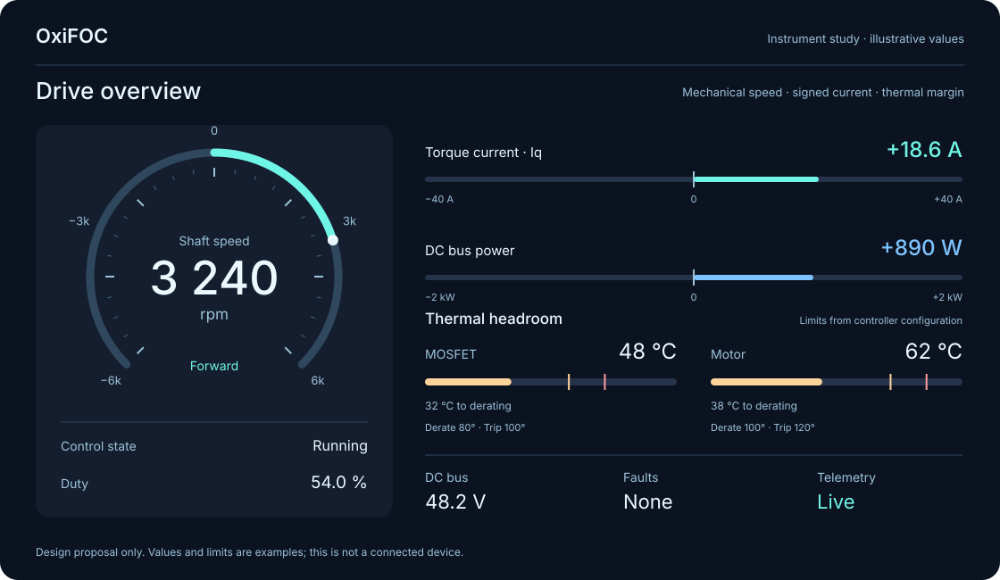

# OxiFOC visual direction

## Brand and surfaces

The user-supplied `oxifoc-icon.svg` is retained as a vector asset in `assets/`.
Only its radial glow is clipped to the rounded tile; the source in Downloads
is unchanged. `Brand` embeds the asset as an SVG data URL so Native and WebView
need no asset server. Launcher and window icons use generated assets from this SVG.

| Role | Dark | Light |
| --- | --- | --- |
| Canvas | `#0b1321` | `#eef5f8` |
| Panel | `#141e2e` | `#ffffff` |
| Primary action | `#6ff5e6` | `#087f79` |
| Primary text | `#eaf9ff` | `#141e2e` |
| Secondary text | `#9dc3da` | `#42647b` |
| Additional series | `#7dc3ff`, `#ffd49a` | `#2765b6`, `#a95a13` |

Use the icon's gradients inside the logo, with quiet solid surfaces around it.
Keep the existing Inter / Roboto / DejaVu Sans font stack. Use tabular figures
for changing values. Turquoise identifies primary interactions and the first
plot series; faults retain a distinct red plus a textual state.

The Native plot workspace now uses this palette too, without changing its
layout. `PLOT_COLORS` matches the dark CSS series tokens. The plot shader already converts sRGB inputs to linear colors for rendering.

## VESC Tool reference

Inspected local checkout `motor_control/vesc_tool` at `f4ec39a5`:

- `mobile/CustomGauge.qml`: numeric value, unit, ticks, short pointer, signed
  filled trace from zero, and 100 ms OutCirc interpolation. This is the active
  component; `CustomGaugeV2.qml` is a separate older implementation.
- `mobile/RtData.qml`: current, duty, ERPM and power in a 4-column or 2-column
  arrangement. Temperature and voltage also appear in the text summary.
- `mobile/RtDataSetup.qml`: a large speed instrument, overlapping groups for
  current/duty/power and ESC/motor temperature/consumption. Temperature color
  changes near configured derating thresholds.
- `pages/pagertdata.cpp`: desktop engineering view emphasizes time-series
  graphs, including separate MOSFET and motor temperature traces.

The setup page was rendered from the local QML using the existing VESC Tool
binary and its `--loadQml` option, without connecting to hardware. The existing
binary is an older build; the inspected QML was loaded from the checkout.
No VESC source was copied into OxiFOC or modified.

## Instrument design

This SVG is a static design study with illustrative values, not a live screen
or telemetry fixture. It defines three reusable visual primitives:

1. **Speed dial.** One prominent open 270-degree arc with a short marker,
   sparse ticks, a large value and a separate direction label. Signed shaft
   RPM, with a stable configured range; ERPM must be explicitly labeled when
   that is the available quantity. Vehicle speed needs gearing and wheel data.
2. **Signed meter.** A zero-centered strip for Iq or DC bus power, with explicit
   units and separate positive/negative limits. Negative bus power can indicate
   regeneration under the backend's sign convention; negative Iq alone is not
   sufficient to make that claim. Asymmetric limits are supported by design.
3. **Thermal meter.** MOSFET and motor side by side, with measured temperature,
   derating-start marker, trip marker and remaining margin. Thresholds must
   come from the controller configuration. Hide the margin when unknown.
   A compact arc variant is possible for a user-selectable instrument panel.

Voltage and duty use compact numeric readings. Do not infer battery state of
charge solely from bus voltage. Faults and stale telemetry use explicit text
as well as color. Missing/invalid values are shown as unavailable, not zero.
Clamp only the graphical marker; retain an out-of-range numeric reading and
state. Do not silently change the scale during a run.

On desktop: speed at left, signed/thermal meters at right, full plots below.
On a narrow screen: a smaller speed dial, then signed meters, then thermal
rows. Reuse the same measurement models and components with different layout.
Do not shrink a desktop instrument cluster until labels become unreadable.

Implementation candidate: SVG paths for dial geometry and ordinary Dioxus
text/controls, with literal SVG colors for Blitz. Rust computes angle, fill,
threshold positions and validity. Interpolate only visual markers for roughly
80–120 ms; errors and loss of data update immediately. Respect reduced motion.
Keep the existing WGPU pipeline for high-rate traces. Rendering cost and
animation smoothness still need measurement once these components exist.

## Validation of the branding change

Native and WebKitGTK builds pass. The embedded SVG and navy/turquoise theme
were visually checked in Native and compact WebKitGTK, including the light
theme. The Native plot workspace was also checked with TCP telemetry from
`oxifoc-virtual`, without sending motor commands. Android uses the same
components, but this branding revision has not been installed on a phone yet.

## Initial instrument implementation

`SpeedDial`, `SignedMeter`, `ThermalMeter` and the adaptive `Instruments` group
are now shared Dioxus components. Native uses actual mechanical RPM, calibrated
Iq and slow FET/motor temperatures; WebView uses the same measurements and builds current calibration off the UI thread. Fast
readings expire after two seconds, slow readings after three. Disconnected,
missing and non-finite readings become unavailable. Display ranges are fixed
and explicitly labeled; a reading outside the range retains its numeric value.

DC bus power is unavailable in the current stream. It is not estimated from
Iq and bus voltage. The thermal component accepts derating/trip markers, but
the connected screen currently has no verified trip configuration mapping,
so it explicitly reports unavailable limits. A derating ramp end must not be
presented as a hardware trip threshold. Meter fills interpolate for 100 ms using CSS; the
SVG dial currently follows each UI sample immediately. Reduced motion disables
meter transitions. Android runtime validation remains pending for these widgets.

Native instruments were visually checked with actual virtual-controller TCP
telemetry and in a 420-pixel catalogue window. The latter is explicitly
labeled reference data. [Native runtime screenshot](instruments-native.png).
WebKitGTK was also connected over TCP: calibrated Iq, mechanical speed,
FET temperature and the absent motor-temperature state rendered correctly.
Stopping the virtual controller changed the WebView to Reconnecting and cleared
all instrument values, rather than leaving their last readings displayed.
